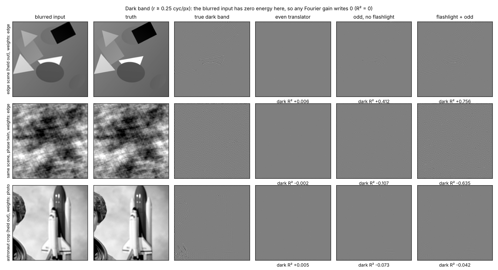

# JanusBoxCabbageSihtiX

**Flashlight + translator: can a writer put back image detail where a blurred input has none?**

Open `index.html` in a browser (offline, no install). It regrows the erased fine band of an image live, with weights trained in this repo, and has the kill switches built in.



## The question

Blur an image so nothing above 0.25 cycles/pixel survives (the **dark zone**). Every writer in the SighImageX family is a Fourier gain on the input: magnitude-only. A gain times zero is zero, so **no magnitude-only writer can put anything in the dark zone**. This is exact, not empirical (`tests/test_core.py::test_any_fourier_gain_writes_nothing_dark`).

To write there you must make new frequencies, which means a nonlinear writer. The proposal split it in two:

* **Flashlight** decides *where*: the unsigned amplitude of the octave below (the parent band, |p|) and the cross-scale phase agreement between parent and grandparent, `pc = |p+q| / (|p|+|q|)`.
* **Translator** decides *what*: a pointwise bend of the parent coefficient whose harmonics land in the dark zone.

Janus Cabbage had phase as the address and Sihti had the bands. The missing part was an outside reader that can tell a fixed filter from something that writes. This repo includes one.

## The sign trap (found while building)

The obvious translator is phase doubling, `p²/|p|`: it moves the parent's clock hand to the next octave. Together with `|b|`, it is **even**: negate the image and the feature stays the same. The detail it has to write is **odd**: negate the image and the fine band flips. Averaged over a world that contains both signs, an even writer's best weight is zero. The translator has to be odd, for example `clip(b)`, `sign(b)·b²`, or phase *tripling* `p³/|p|²`.

Every feature is homogeneous of degree 1, so contrast does not change what any writer does.

## Ledger

Dark-band R² on held-out images (`results/receipt.json`). 0 means "wrote nothing"; negative means it wrote the wrong thing. Training: 69 photo crops from 16 scikit-image photos; 60 synthetic edge scenes (anti-aliased shaded shapes). Test: 11 crops from 4 photos never used in training (astronaut, coffee, chelsea, grace_hopper); 20 edge scenes from a different seed; phase-scrambled twins of both.

| writer | trained on | edge test | edge twins | photo test | photo twins |
|---|---|---|---|---|---|
| any Fourier gain (SighImageX family) | – | **0** (exact) | 0 | 0 | 0 |
| even translator (\|b\|, p²/\|p\|, gated) | edge | −0.002 | −0.002 | −0.001 | −0.002 |
| odd translator, no flashlight | edge | +0.432 | −0.089 | −0.068 | −0.072 |
| tripled clock hands only (p³/\|p\|², gated) | edge | +0.661 | −0.412 | −0.194 | −0.332 |
| **flashlight + odd translator** | edge | **+0.746** | −0.586 | −0.205 | −0.475 |
| flashlight + odd translator | photo | +0.312 | −0.014 | **+0.053** | −0.011 |
| flashlight + odd translator | photo + edge | +0.680 | −0.181 | −0.005 | −0.142 |

Controls (flashlight + odd, edge-trained, on edge test): parent features rolled by 64×96 px → **−0.559**; parent features taken from the next image → **−0.762**. Photo-trained on photo test: −0.041 and −0.039.

The whole fine band (transition zone, where a radial EQ works, plus the dark zone): the dark zone holds 60% of the erased energy on edge scenes and 63% on photos.

| fine-band R² | edge test (edge weights) | photo test (photo weights) |
|---|---|---|
| blurred input | 0 | 0 |
| EQ on what survived (magnitude-only, 9-knot radial) | 0.380 | 0.354 |
| EQ + flashlight + odd translator | **0.829** | 0.387 |

The radial EQ alone gets R² ≈ 0.95 in the transition zone. That ceiling is set by the dark zone, not by the EQ.

### What this shows

1. **The sign trap is real.** The even translator scores 0.000 ± 0.002 everywhere, in every world. It is not "a weak translator"; it has the wrong symmetry.
2. **On edges, the split works.** The flashlight gate adds a lot on top of the odd translator (0.432 → 0.746). The largest weights in the edge-trained writer are `clip(b)·pc⁴` in all four orientations (weights 3.4–3.7, `results/weights.json`). That is Greenspan's clip, switched on only where the parent and grandparent phases agree.
3. **The kill test works.** Phase twins keep every Fourier magnitude and lose cross-scale phase alignment. The edge writer then does worse than writing nothing (−0.586). So it is using phase structure, not the spectrum. The same holds when the parent is displaced or swapped.
4. **On photographs it fails.** Trained on photos it reaches only +0.053. Trained on edges, or on edges plus photos, it is at or below zero on photos. With the mixed weights, 3 of the 11 photo crops are positive (best +0.30) and one astronaut crop reaches −0.85. Photos in this set are mostly texture, fur and soft shading, where the next octave is not a fixed function of the parent's local phase. A single linear readout over this dictionary cannot regrow them.
5. **Negation is a sanity check, not evidence.** Odd writers keep exactly the same score on the negative image by construction (`receipt.json → flip`). The even writer has nothing to lose.

## The outside reader

`jbx/reader.py` treats a writer as a sealed box. It sends inputs and reads outputs only. It runs four probes: dark-zone energy, additivity, negation parity, and residue-guided greedy dictionary recovery on held-out pixels (Luotain2 style).

| box | reader's verdict | additivity error | recovered |
|---|---|---|---|
| magnitude-only EQ | EQ / linear filter: nothing written where the input is dark | – | – |
| hidden tripler `0.6·tri0 − 0.4·triI2` | odd translator | 0.67 | exactly those two, weights 0.600, −0.400 |
| trained flashlight + odd (32 weights) | odd translator | 0.60 | all 32, rel. weight error 4e−13, residue 8e−15 |
| trained even writer | even translator | 0.71 | 24 terms, residue 6e−15 |
| \|p\| × fixed random phase | writes new frequencies, but outside the dictionary (climb higher) | 0.23 | unexplained fraction 1.0 |

Honest scope: recovering boxes that are built from the reader's own dictionary only checks that the reader is internally consistent. The useful verdict is the last row: it says when a box writes something this vocabulary cannot name, and it does not invent an explanation.

## Prior art (this is not new physics)

* Greenspan, Anderson & Akber, *Image enhancement by nonlinear extrapolation in frequency space*, IEEE TIP 2000: high-pass, clip, high-pass again. Our strongest single term is their clip. What is added here is the pc gate, the sign analysis and the controls.
* Portilla & Simoncelli 2000, texture model: phase-doubled parent coefficients correlated with child coefficients. The doubling is exactly where the sign problem lives. They use it as a statistic, not as a signed writer.
* Phase congruency (Morrone & Owens 1987; Kovesi 1999): features are where phases across scales agree. Our flashlight is a two-scale version of it.
* Complex steerable pyramids and phase-based motion magnification (Wadhwa et al. 2013): local phase as the clock hand.
* Learned super-resolution (SRCNN onward) and frequency-domain token mixers (AFFNet ICCV 2023, DFFormer AAAI 2024) do far better on photos. This repo does not compete with them. It is a small, readable, closed-form operator with the kill tests attached.

## Run it

Windows, Python 3.13:

```
py -3.13 -m pip install -r requirements.txt
py -3.13 -m pytest -q tests            # 10 tests, ~15 s
py -3.13 experiment.py                 # ~4 min on CPU -> results/receipt.json, results/weights.json
py -3.13 figure.py                     # results/figure.png
py -3.13 build.py                      # index.html (embeds web/jbx.js, weights, 4 held-out crops)
node tests/test_js.js                  # browser core vs Python core (agree to ~1e-11)
```

On Linux or macOS use `python3` in place of `py -3.13`. No GPU is used. Everything is NumPy FFTs and normal equations.

## Files

* `jbx/bands.py`: the fixed geometry. 256→512 mirror extension, fine, parent and grandparent bands, dark zone, K = 4 one-sided steerable windows.
* `jbx/writers.py`: the feature dictionary (odd, even, gated), the radial EQ basis, Gram accumulation.
* `jbx/reader.py`: the outside reader.
* `jbx/data.py`: photo crops, edge world, phase twins.
* `experiment.py`: train, test, controls, reader → `results/`.
* `web/jbx.js` + `web/template.html` → `index.html`: the live page. Buttons: negate, phase twin, shift parent, choice of training world, load your own image.

## Next rung

The reader says where to climb: photos need a writer whose output is not a fixed function of the local parent phase. The cheapest next test is to let the flashlight select among a few translators by local texture statistics (a mixture of experts on the same dictionary), then re-run the same twin and shift controls. If that does not move photos above zero, the dark zone of a photograph is not recoverable from one octave below, and the ledger should say so.

Built by Claude (Opus 5.5) on the bands from SighImageX, BlackBoxSpotlight (Astra) and SighImageInverse (Sol).
